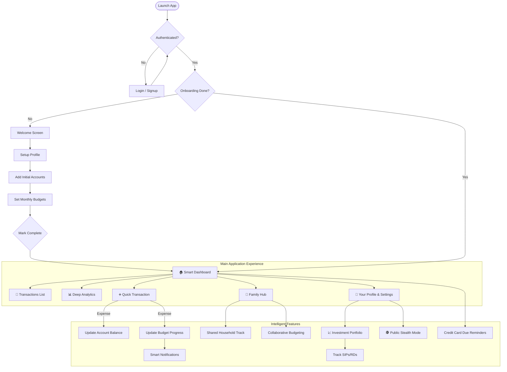

# 💰 KOSH

A premium personal finance management suite built with **React Native** and **Expo**, powered by a robust **Firebase** backend. Take command of your financial journey with real-time tracking, intelligent budgeting, and an advanced investment portfolio tracker — all wrapped in a sleek, intuitive interface.

---

## 📱 Application Flow

Understanding how the application flows from a first-time user to a power user.



---

## ✨ Key Features

### 🏠 Intelligent Dashboard
- **Dynamic Net Worth**: Real-time calculation of Assets – Debts ± Investments (configurable).
- **Smart Alerts System**: Instant warnings for credit card dues, budget overruns (80%/100%), and high credit utilization.
- **Account Carousel**: Quick glance at bank balances and credit card usage with visual progress bars.
- **Recent Activity**: Categorized overview of your latest financial moves.

### 💸 Financial Tracking
- **Unified Recording**: Add expenses or income with category-specific icons, payment modes, and custom notes.
- **Credit Card Intelligence**: Mark transactions as debt, automatically updating credit utilization and available limits.
- **Auto-Balance Sync**: Seamlessly updates your account balances across bank, cash, and credit accounts with every transaction.

### 📊 Advanced Analytics
- **Category Deep-Dive**: Horizontal bar charts showing exactly where your money goes.
- **Daily Spending Trends**: Scrollable bar charts to visualize spending patterns over the month.
- **Payment Mode Analysis**: See the split between UPI, Debit, Credit, and Cash spending.
- **Comparison Engine**: Navigate through months to track your financial growth and saving trends.

### 👥 Family Management (New)
- **Collaborative Tracking**: Create or join a family unit to manage shared household expenses.
- **Role-Based Access**: Manage permissions with Owner, Co-Admin, and Member roles.
- **Invite System**: Seamless onboarding via unique 6-digit family invite codes.
- **Shared Budgets**: Set family-wide spending limits and track collective progress.
- **Member Insights**: See who spent what and compare spending patterns across the family.

### 📈 Investment Portfolio (Pro)
- **Multi-Asset Support**: Track 11+ investment types including Mutual Funds, Stocks, Gold, Crypto, FD, and PPF.
- **SIP & RD Tracking**: Automated reminders for monthly payments with a dedicated "Confirm/Skip" workflow.
- **Maturity Auto-Credit**: Link investments to bank accounts for automatic crediting upon maturity.
- **Performance Overview**: Track invested amount vs. current value with ₹ and % return metrics.

### 🎯 Proactive Budgeting
- **Granular Control**: Set overall monthly limits or category-specific targets.
- **Visual Progress**: Color-coded bars (Green → Amber → Red) keep you disciplined.
- **Notification Engine**: Get instant pings for budget thresholds (50%, 80%, 100%) and daily summaries.

### 🕵️ Privacy & Smart Insights
- **Public Stealth Mode**: Instantly mask sensitive balances and values in public with a single tap.
- **Spending Personality**: Monthly AI-driven analysis of your financial behavior (e.g., "The Saver", "The Spender").
- **Data Portability**: Export your entire transaction history to CSV or PDF for external auditing.

---

## 👥 Family Role Permissions Matrix

Here is exactly what each role can do in the app based on the latest implementation:

| Action / Feature | 👑 Owner | 🛡️ Co-Admin | 👤 Member |
|---|:---:|:---:|:---:|
| **Family Management** | | | |
| Create a family | ✅ | - | - |
| Leave family | ✅ (Transfers) | ✅ | ✅ |
| Delete entire family | ✅ | ❌ | ❌ |
| Rename family | ✅ | ❌ | ❌ |
| Transfer Ownership | ✅ | ❌ | ❌ |
| **Member Management** | | | |
| Invite members (View Code) | ✅ | ✅ | ❌ |
| Regenerate Invite Code | ✅ | ✅ | ❌ |
| Remove a Member | ✅ | ✅ | ❌ |
| Promote/Demote Co-Admin | ✅ | ❌ | ❌ |
| **Expenses & Split** | | | |
| View all family expenses | ✅ | ✅ | ✅ |
| Add new family expense | ✅ | ✅ | ✅ |
| Edit/Delete Own expense | ✅ | ✅ | ✅ |
| Edit/Delete Others' expense | ✅ | ✅ | ❌ |
| Use Custom/Percentage Splits | ✅ | ✅ | ✅ |
| **Budgets & Analytics** | | | |
| View Budgets & Analytics | ✅ | ✅ | ✅ |
| Set/Edit Monthly Budgets | ✅ | ✅ | ❌ |
| Receive Budget Alerts | ✅ | ✅ | ✅ |
| Export to CSV / PDF | ✅ | ✅ | ✅ |
| **Automation** | | | |
| View Recurring Templates | ✅ | ✅ | ✅ |
| Create/Edit/Delete Templates | ✅ | ✅ | ❌ |

---

## 🛠️ Technology Stack

| Layer | Technology |
|---|---|
| **Core Framework** | React Native 0.81 + Expo SDK 54 |
| **Logic Engine** | Javascript (ES6+) |
| **Navigation** | React Navigation 7 (Native Stack + Bottom Tabs) |
| **State Management**| Zustand 5 (High-performance state) |
| **Backend** | Firebase 12 (Auth, Firestore, Cloud Storage) |
| **Interactions** | React Native Reanimated 4 + Gesture Handler |
| **Analytics** | Firebase Analytics (Custom Event Tracking) |
| **Forms** | React Hook Form + Yup Validation |
| **Storage** | SecureStore (Credentials) + AsyncStorage (Persistence) |

---

## 📂 Architecture

```
ExpenseManager/
├── src/
│   ├── navigation/        # Root, Auth, Onboarding, and Family Navigators
│   ├── screens/           # UI implementations (Grouped by Home, Family, Invest, etc.)
│   ├── services/          # Logic (Auth, Family, Expense, Notification, Export)
│   ├── store/             # Zustand stores (User, Family, Notifications, Accounts)
│   ├── config/            # Firebase and environmental configuration
│   ├── components/        # Reusable UI (Family, Notifications, Layout, Charts)
│   ├── utils/             # Helpers (Formatters, Validators, Code Generators)
│   └── constants/         # Theme, Colors, Roles, and Static Data
├── assets/                # App icons, splash, and animation assets
└── App.js                 # Application entry point
```

---

## 🐳 Quick Start with Docker (Recommended)

Run KOSH without installing Node.js or project dependencies locally. You only need **Docker** (with Docker Compose) and a **Firebase Project**.

```bash
# 1. Clone the repository
git clone https://github.com/pavanvaranasi02/Expense-Manager
cd Expense-Manager

# 2. Create .env and add your Firebase credentials
cp .env.example .env

# 3. Start the app
docker compose up --build
```

- **Mobile (Expo Go):** Scan the QR code printed in the terminal with the **Expo Go** app (Android) or **Camera** app (iOS).
- **Web Browser:** Run the web profile instead and open `http://localhost:8081`:
  ```bash
  docker compose --profile web up --build web
  ```

> [!NOTE]
> Native emulator builds (`npm run android` / `npm run ios`) require running locally outside Docker (see [Setup & Installation](#-setup--installation) below).

---

## 🚀 Setup & Installation

Follow these steps to set up and run KOSH locally for the first time.

### 1. Prerequisites
- **Node.js** (v22.13 or higher) and **npm**
- **Git**
- **Expo Go** app on your iOS/Android device (or Android Studio / Xcode for emulators/simulators)
- A **Firebase Project** (with Authentication, Cloud Firestore, and Cloud Storage enabled)

### 2. Clone & Install Dependencies
```bash
# Clone the repository
git clone https://github.com/pavanvaranasi02/Expense-Manager
cd Expense-Manager

# Install dependencies
npm install
```

### 3. Environment & Firebase Configuration
Create a `.env` file in the project root from the provided template:
```bash
cp .env.example .env
```

Open `.env` and fill in your Firebase project credentials (found in **Firebase Console → Project Settings → General → Your Apps → Web App**):
```env
EXPO_WEB_CLIENT_ID=
EXPO_PUBLIC_FIREBASE_API_KEY=your_api_key
EXPO_PUBLIC_FIREBASE_AUTH_DOMAIN=your_project_id.firebaseapp.com
EXPO_PUBLIC_FIREBASE_PROJECT_ID=your_project_id
EXPO_PUBLIC_FIREBASE_STORAGE_BUCKET=your_project_id.firebasestorage.app
EXPO_PUBLIC_FIREBASE_MESSAGING_SENDER_ID=your_sender_id
EXPO_PUBLIC_FIREBASE_APP_ID=your_app_id
EXPO_PUBLIC_FIREBASE_MEASUREMENT_ID=your_measurement_id
```

> [!NOTE]
> `src/config/firebase.js` and `app.config.js` read these `EXPO_PUBLIC_FIREBASE_*` environment variables automatically—you do not need to hardcode credentials in `src/config/firebase.js`.
> Make sure **Email/Password** authentication, **Cloud Firestore**, and **Cloud Storage** are enabled in your Firebase project.

### 4. Start the App
Start the Expo development server (use `--clear` after creating or updating `.env`):
```bash
npx expo start --clear
```

From the Expo CLI menu (or via npm scripts), you can launch the app on your preferred target:
- **Mobile Device (Expo Go):** Scan the QR code using the Expo Go app (Android) or Camera app (iOS).
- **Android Emulator / Device (Native Build):**
  ```bash
  npm run android
  ```
- **iOS Simulator / Device (Native Build, macOS only):**
  ```bash
  npm run ios
  ```
- **Web Browser:**
  ```bash
  npm run web
  ```

---

## 🔒 Security & Privacy
- **Secure Persistence**: User sessions and preferences are stored using encrypted device storage.
- **Private Data**: All financial information is siloed per-user in Firebase Firestore with strict security rules.
- **Danger Zone**: Full account and data deletion capabilities available in user settings.

---

<p align="center">
  Built with ❤️ for Financial Freedom
</p>
